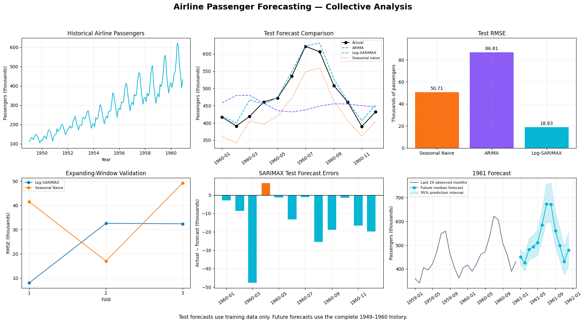

# Airline Passenger Forecasting

Historical passenger forecasts with chronological validation, residuals and 1961 forecast uncertainty.

## Collective dashboard

**Log-SARIMAX RMSE 18.83 · Seasonal-naive RMSE 50.71 · ARIMA RMSE 86.81**

[View analysis](https://safdar404.github.io/applied-ml-analysis/#airline-forecast) · [Open original PNG](https://safdar404.github.io/assets/ml-dashboards/airline-forecast.png) · [All eight studies](../README.md)

## Evaluation context

Results above are transcribed from the supplied dashboard screenshot, not newly computed benchmarks. Forecast extensions concern historical 1961 demand. This folder documents the dashboard; it does not contain a runnable notebook or trained model. Streamlit deployment is pending.

## Author

[Muhammad Safdar](https://github.com/safdar404) · [Portfolio](https://safdar404.github.io/)
