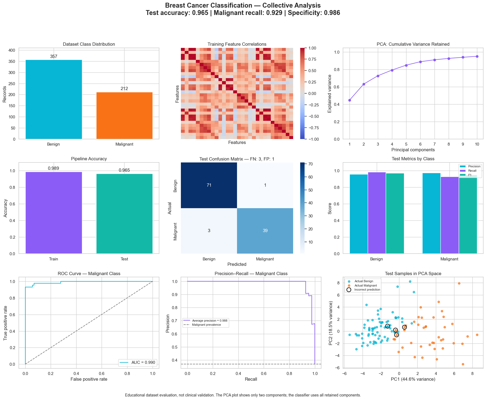

# Breast Cancer Classification

StandardScaler → PCA → SVC evaluation with malignant recall, specificity, confusion matrix and precision–recall analysis.

## Collective dashboard

**Accuracy 96.5% · Malignant recall 92.9% · ROC AUC 0.990**

[View analysis](https://safdar404.github.io/applied-ml-analysis/#cancer) · [Open original PNG](https://safdar404.github.io/assets/ml-dashboards/cancer.png) · [All eight studies](../README.md)

## Evaluation context

Results above are transcribed from the supplied dashboard screenshot, not newly computed benchmarks. Educational classification, not clinical diagnosis. This folder documents the dashboard; it does not contain a runnable notebook or trained model. Streamlit deployment is pending.

## Author

[Muhammad Safdar](https://github.com/safdar404) · [Portfolio](https://safdar404.github.io/)
