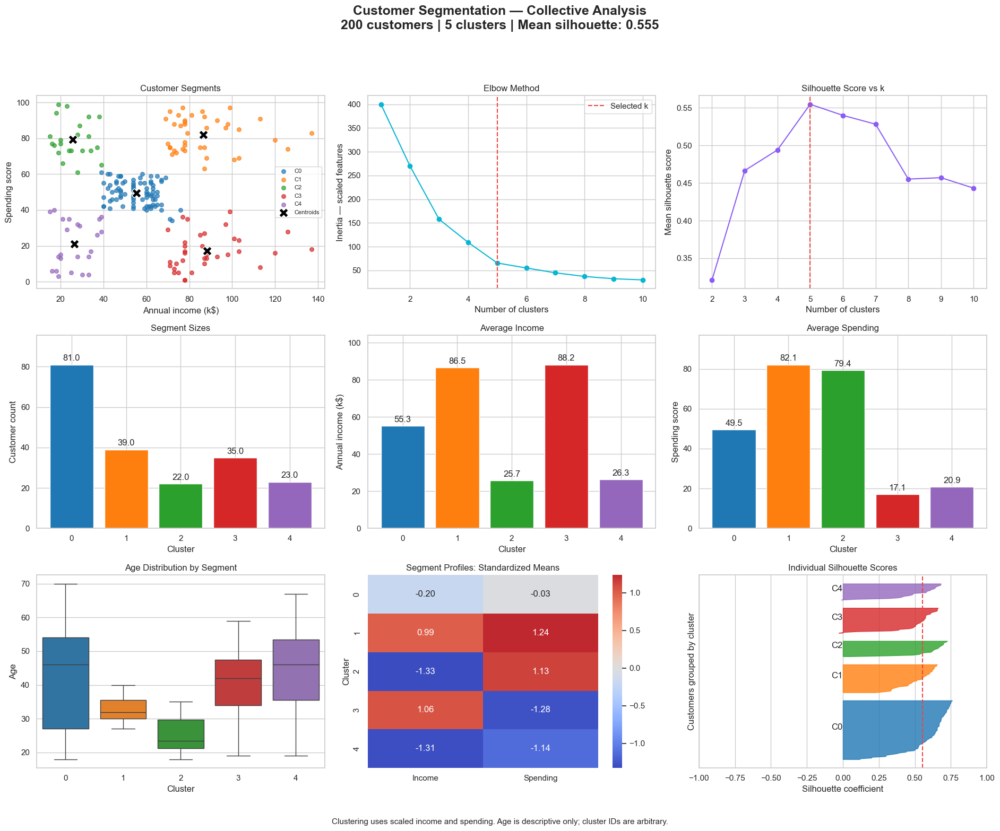

# Customer Segmentation

K-Means customer profiles, cluster sizes, elbow and silhouette analysis; cluster IDs are arbitrary.

## Collective dashboard

**200 customers · 5 clusters · Silhouette 0.555**

[View analysis](https://safdar404.github.io/applied-ml-analysis/#customer-segmentation) · [Open original PNG](https://safdar404.github.io/assets/ml-dashboards/customer-segmentation.png) · [All eight studies](../README.md)

## Evaluation context

Results above are transcribed from the supplied dashboard screenshot, not newly computed benchmarks. This folder documents the dashboard; it does not contain a runnable notebook or trained model. Streamlit deployment is pending.

## Author

[Muhammad Safdar](https://github.com/safdar404) · [Portfolio](https://safdar404.github.io/)
