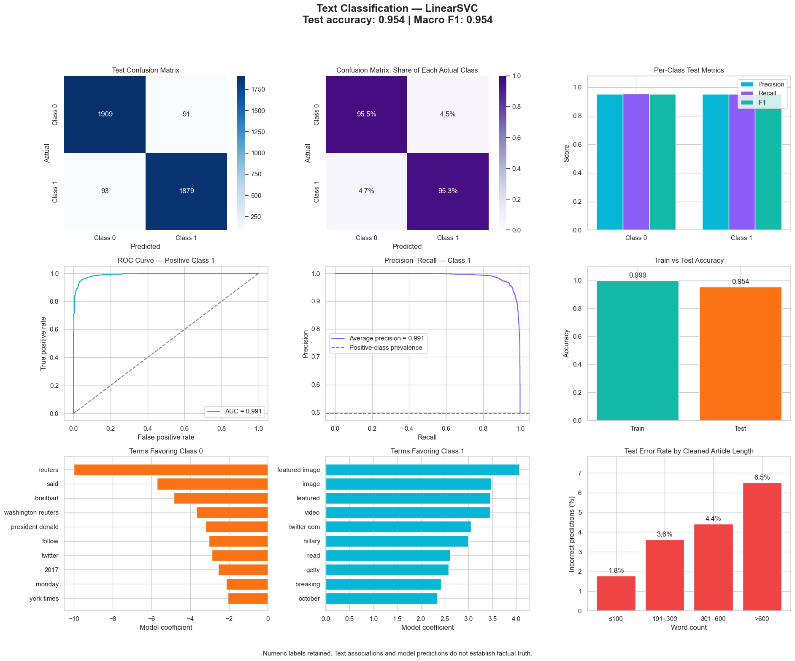

# Fake News Text Classification

TF-IDF and LinearSVC evaluation with term weights and errors by text length; numeric class labels are retained.

## Collective dashboard

**Accuracy 95.4% · Macro F1 0.954 · ROC AUC 0.991**

[View analysis](https://safdar404.github.io/applied-ml-analysis/#fake-news) · [Open original PNG](https://safdar404.github.io/assets/ml-dashboards/fake-news.png) · [All eight studies](../README.md)

## Evaluation context

Results above are transcribed from the supplied dashboard screenshot, not newly computed benchmarks. Classification does not verify factual truth. This folder documents the dashboard; it does not contain a runnable notebook or trained model. Streamlit deployment is pending.

## Author

[Muhammad Safdar](https://github.com/safdar404) · [Portfolio](https://safdar404.github.io/)
