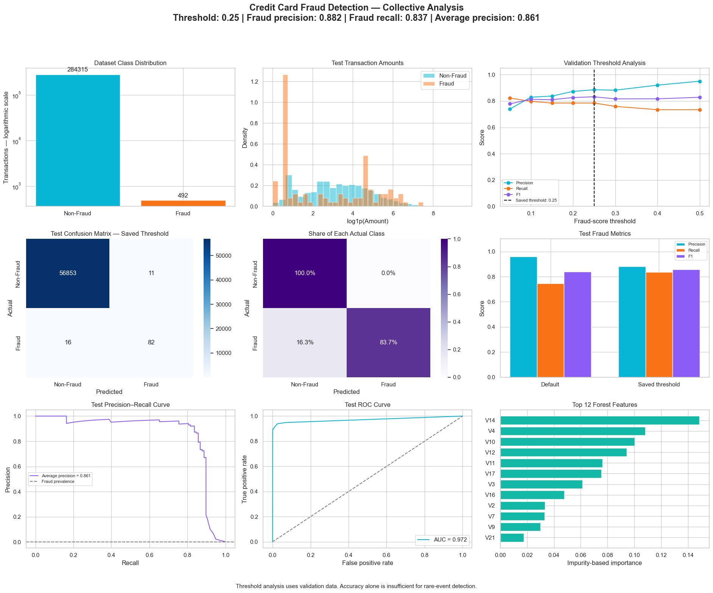

# Credit Card Fraud Detection

Rare-event classification at threshold 0.25: 82 detected frauds, 16 missed frauds and 11 false alarms.

## Collective dashboard

**Fraud recall 83.7% · Precision 88.2% · Average precision 0.861**

[View analysis](https://safdar404.github.io/applied-ml-analysis/#fraud) · [Open original PNG](https://safdar404.github.io/assets/ml-dashboards/fraud.png) · [All eight studies](../README.md)

## Evaluation context

Results above are transcribed from the supplied dashboard screenshot, not newly computed benchmarks. This displayed run differs from the earlier comparison experiment. Operational fraud-detection reliability is not established. This folder documents the dashboard; it does not contain a runnable notebook or trained model. Streamlit deployment is pending.

## Author

[Muhammad Safdar](https://github.com/safdar404) · [Portfolio](https://safdar404.github.io/)
