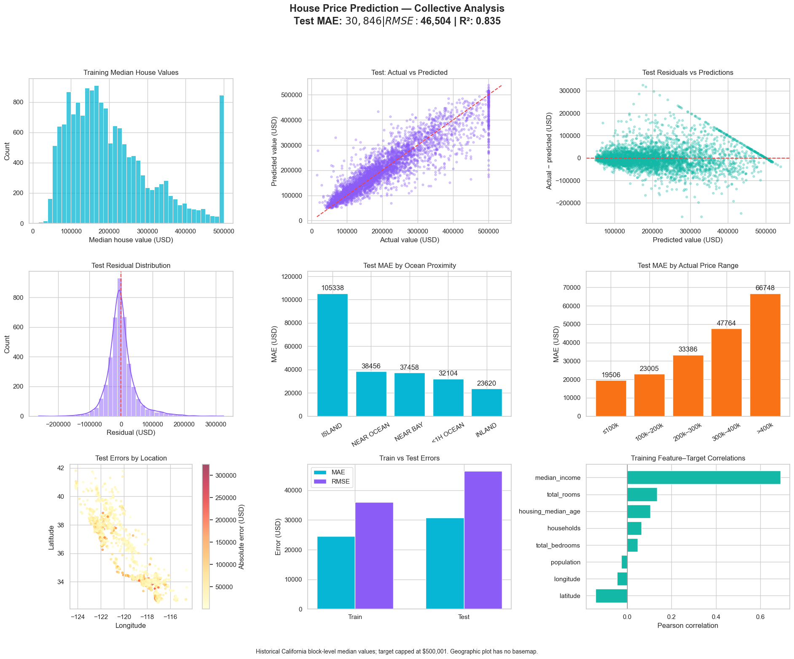

# House Price Prediction

California housing regression with residuals, geographic errors, price-range analysis and feature relationships.

## Collective dashboard

**MAE $30,846 · RMSE $46,504 · R² 0.835**

[View analysis](https://safdar404.github.io/applied-ml-analysis/#house-price) · [Open original PNG](https://safdar404.github.io/assets/ml-dashboards/house-price.png) · [All eight studies](../README.md)

## Evaluation context

Results above are transcribed from the supplied dashboard screenshot, not newly computed benchmarks. This folder documents the dashboard; it does not contain a runnable notebook or trained model. Streamlit deployment is pending.

## Author

[Muhammad Safdar](https://github.com/safdar404) · [Portfolio](https://safdar404.github.io/)
