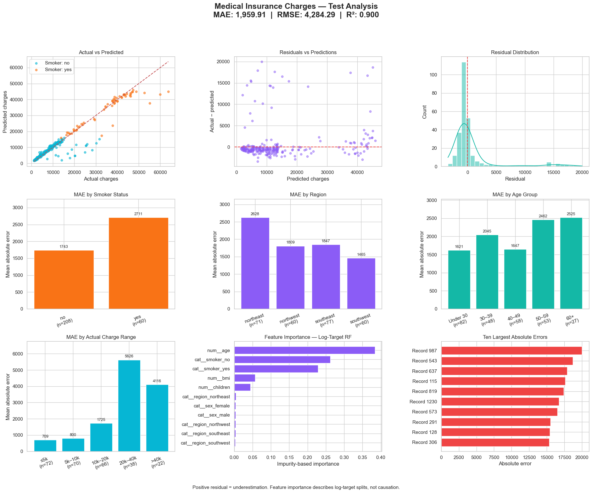

# Medical Insurance Cost Prediction

Log-target random-forest regression with subgroup errors and feature importance.

## Collective dashboard

**MAE 1,959.91 · RMSE 4,284.29 · R² 0.900**

[View analysis](https://safdar404.github.io/applied-ml-analysis/#insurance-cost) · [Open original PNG](https://safdar404.github.io/assets/ml-dashboards/insurance-cost.png) · [All eight studies](../README.md)

## Evaluation context

Results above are transcribed from the supplied dashboard screenshot, not newly computed benchmarks. This folder documents the dashboard; it does not contain a runnable notebook or trained model. Streamlit deployment is pending.

## Author

[Muhammad Safdar](https://github.com/safdar404) · [Portfolio](https://safdar404.github.io/)
