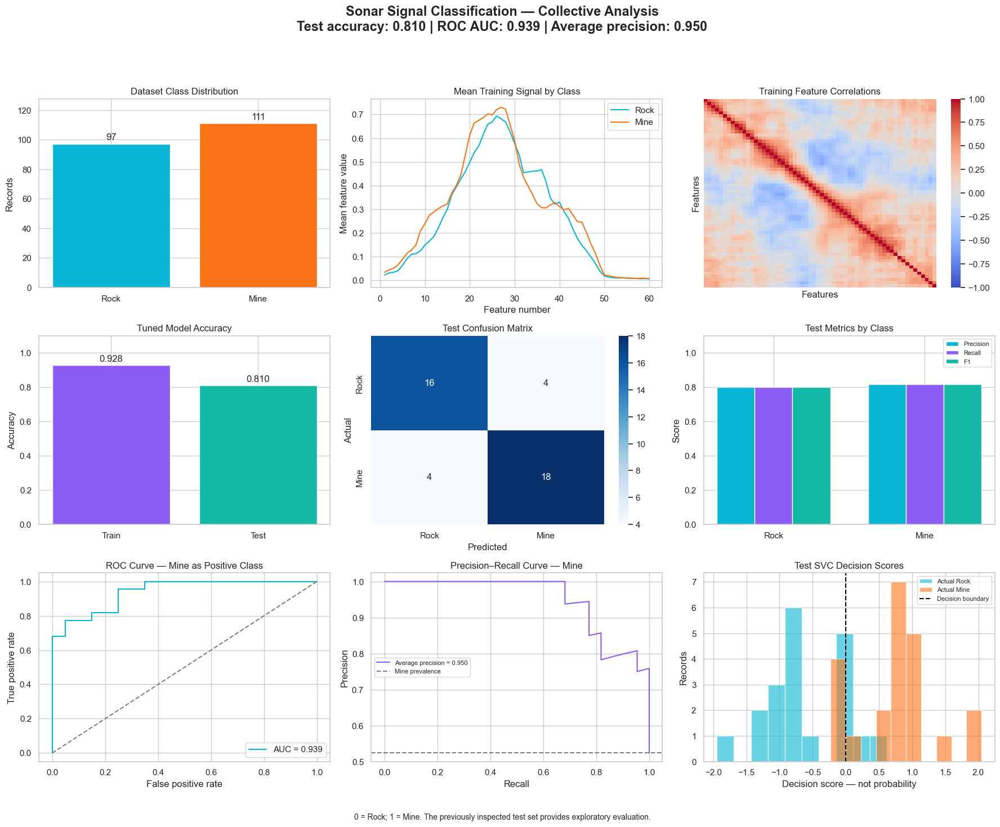

# Sonar Signal Classification

Scaled SVC classification of rock and mine sonar signals; signal profiles, confusion matrix, ROC, precision–recall and decision-score analysis.

## Collective dashboard

**Accuracy 81.0% · ROC AUC 0.939 · Average precision 0.950**

[View analysis](https://safdar404.github.io/applied-ml-analysis/#sonar) · [Open original PNG](https://safdar404.github.io/assets/ml-dashboards/sonar.png) · [All eight studies](../README.md)

## Evaluation context

Results above are transcribed from the supplied dashboard screenshot, not newly computed benchmarks. This displayed run differs from the earlier comparison experiment. This folder documents the dashboard; it does not contain a runnable notebook or trained model. Streamlit deployment is pending.

## Author

[Muhammad Safdar](https://github.com/safdar404) · [Portfolio](https://safdar404.github.io/)
