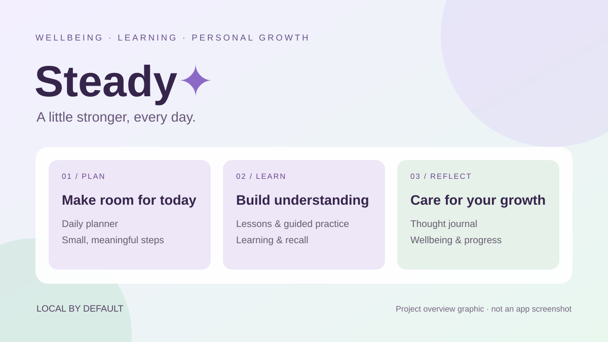

# Steady · Growth Companion

**Small steps. Real growth.**

[Open the live application](https://safdar-mindful-growth.safdarwatto7714.chatgpt.site/) · [Muhammad Safdar's portfolio](https://safdar404.github.io/)

*Branded overview graphic, not an application screenshot.*

## Purpose

A personal growth companion that brings daily planning, learning, reflection and everyday wellbeing into one calm workspace. Steady helps users make time for learning, organize manageable daily actions and reflect on their progress.

## Main workspaces

| Workspace | Purpose |
|---|---|
| Daily planner | Organize daily activities and small next steps. |
| Lesson library and guided practice | Access structured learning and practice. |
| Learn and remember | Support learning and recall routines. |
| Thought journal | Provide a space for personal reflection. |
| Life and wellbeing | Explore everyday wellbeing support. |
| Progress and settings | Review progress and manage preferences. |
| Voice and audio | Access recording and audio-related tools. |
| Patient records and appointment notes | Organize personal records and appointment preparation. |

## Design and data handling

The interface uses a calm purple and soft green visual identity, responsive navigation, and English with partial Urdu support. Entries remain in the browser by default; the app describes optional encrypted text sync/backups and consent-based audio transcription. An interface lock does not encrypt local entries. Full translation and linguistic review remain pending.

Steady provides educational wellbeing support. It does not diagnose or replace professional care; health content has not been clinically reviewed.

## Repository scope

This directory contains the public project showcase and documentation. The hosted application runs at the live link above; its application source is not included in this directory. The preview contains no personal entries, recordings or health records. Features above follow the live app's navigation and published data-handling text; this listing is not an end-to-end functional audit.
